<div align="center">


# 🎓 Smart College Attendance System: Demo (Stage 1)

**AI-powered classroom attendance using face recognition, with the teacher always in control**

<p>
  
  
  
  
  <br/>
  
  
  
  
</p>

<p>
  
  
  
  
</p>

**[🎬 Demo](#-demo-video) · [✨ Features](#-key-features) · [🔄 Workflow](#-system-workflow) · [🧠 AI pipeline](#-ai-and-face-recognition-pipeline) · [📸 Screens](#-screenshots) · [⚙️ Install](#%EF%B8%8F-installation-and-setup) · [🎤 Presenting](#-demo-presentation-guide)**

</div>

> [!IMPORTANT]
> **DEMO MODE ONLY.** This project uses synthetic student records (`Student 001`–`Student 128`) and a controlled face dataset.
> It contains no real college attendance data. Don't use it as a production attendance system, and don't mix its database,
> face gallery, credentials or reports with a future real-college deployment.

---

## 🎬 Demo video

<div align="center">

<a href="docs/demo/attendance-tour.mp4">
  
</a>

**▶️ [Watch the full-quality MP4 (55 s, 1280×720)](docs/demo/attendance-tour.mp4)**

</div>

| ⏱️ | Scene | What you see |
|:-:|---|---|
| 0:00 | **Intro** | What the system does and who it was built for |
| 0:04 | **Workflow** | Seven steps: upload, detect, recognise, merge, roster check, review, finalize |
| 0:10 | **Decision rules** | The thresholds behind **PRESENT**, **REVIEW**, **OTHER CLASS** and **UNKNOWN** |
| 0:15 | **The demo set** | 4 photos → 36 face appearances → **20 different people**, with duplicates merging live |
| 0:22 | **9 app screens** | Home → admin dashboard → students → face enrollment → subject groups → timetable → teacher view → take attendance → reports |

> [!NOTE]
> The app screens are **real screenshots** of this application running locally, with the demo database seeded.
> **Classroom photos are blurred** in the screenshots and video. The *demo set* scene shows the **expected outcome** from
> `demo_assets/manifest.json` (the ground truth used by the tests); it is not a live recognition run. The video is rendered by
> [`scripts/demo/render_tour_video.py`](scripts/demo/render_tour_video.py).

<p align="center">
  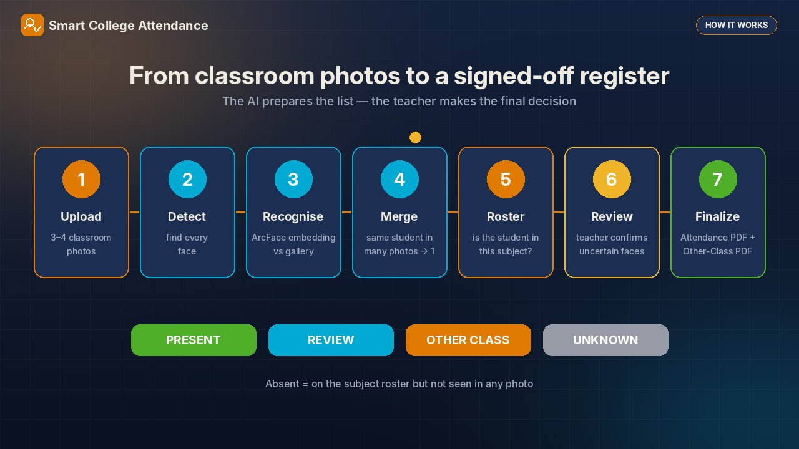
  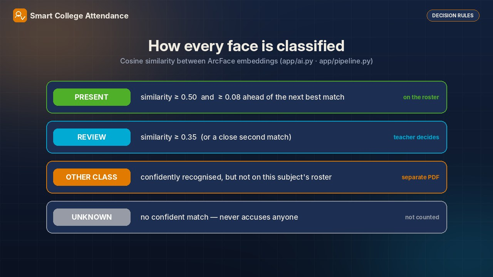
  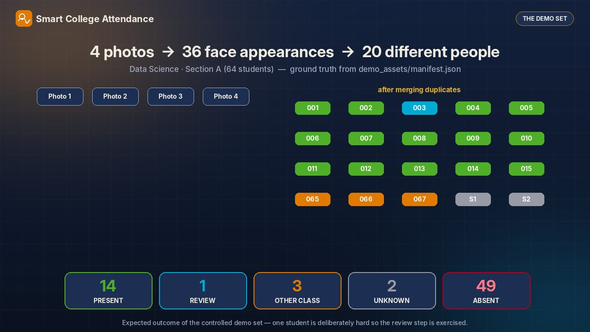
</p>

---

## 🚀 Overview

Marking attendance by calling out 60+ names wastes 5–10 minutes of every lecture. Here, the teacher takes **3–4 photos of the classroom** and the system:

1. 🔍 **detects** every face in every photo,
2. 🧠 **recognises** enrolled students with InsightFace (ArcFace embeddings),
3. 🔗 **merges** the same student seen in several photos into one row,
4. 📋 **checks the subject roster**, so a student from another section is flagged as **OTHER CLASS** instead of being marked present,
5. 👩‍🏫 lets the **teacher review** anything uncertain, and
6. 📄 produces an **Attendance PDF** and a separate **Other-Class PDF**.

> The AI prepares the list. **The teacher makes the final decision.**

## ✨ Key features

<table>
<tr>
<td width="50%" valign="top">

### 🧠 AI and recognition
- 📸 **Multi-photo processing**: 3–4 classroom photos per session
- 🙂 **Face detection + recognition** with InsightFace (`buffalo_sc`)
- 🔗 **Duplicate merging** across photos, for strangers as well
- 📋 **Subject eligibility check** for core and elective rosters
- 🟢🔵🟠⚪ **Four clear outcomes**: Present · Review · Other class · Unknown
- 🛡️ **Never accuses on a weak match**: low similarity becomes *Unknown*

</td>
<td width="50%" valign="top">

### 🏫 College workflow
- 👤 **Two roles**: admin (set-up) and teacher (attendance)
- 🗂️ **Admin**: students, enrollment, face enrollment, subjects, groups, teachers, assignments, timetable
- 📅 **Teacher**: today's classes, start attendance, upload, run AI, review, finalize
- 🖼️ **Face crops** shown for every decision during review
- 📄 **PDF reports** (ReportLab) for attendance and other-class sightings
- 🐳 **Docker** image · optional **Vercel** front door · 📱 mobile-friendly UI

</td>
</tr>
</table>

## 🏫 Demo environment

| Parameter | Demo configuration |
|---|---|
| 🏛️ College | Sai Vidya Institute of Technology |
| 💻 Department | CSE – Data Science |
| 🎓 Semester | 7th Semester |
| 🅰️ Section A | Student 001 – Student 064 (`01DEMO23DS001`–`064`) |
| 🅱️ Section B | Student 065 – Student 128 (`01DEMO23DS065`–`128`) |
| 📘 Core subject | **Data Science** (Section A, 64 students) |
| 📗 Elective | **Cloud Computing** (A+B elective group, 64 students) |
| 🗓️ Timetable | Every weekday: Hour 1 09:00–10:00 (Data Science), Hour 5 13:30–14:30 (Cloud Computing) |
| 🙂 Face profiles | 18 enrolled identities (3 gallery photos each) |

## 🔄 System workflow

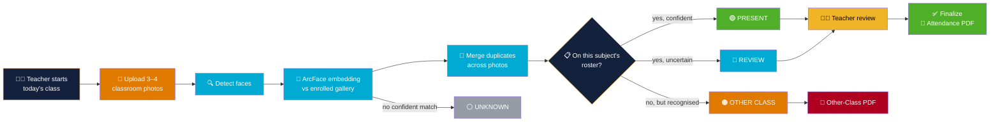

## 🧠 AI and face-recognition pipeline

| Stage | What happens | Code |
|---|---|---|
| **Quality and decode** | Each photo is read, checked and resized | `app/ai.py → read_image, image_quality` |
| **Detection** | InsightFace finds every face (bounding box + landmarks) | `ai.detect_boxes` |
| **Embedding** | Each face becomes a 512-d ArcFace vector | `ai.embed_faces` |
| **Matching** | Cosine similarity against every enrolled student's gallery; the best and second-best scores are kept | `ai.match` |
| **Classification** | Thresholds below | `ai.classify` |
| **Merging** | The same student across photos keeps the best detection. Strangers seen twice (similarity ≥ 0.45) count once | `app/pipeline.py` |
| **Roster check** | A confidently recognised student who isn't eligible for the subject becomes **OTHER CLASS** | `app/pipeline.py` |
| **Annotated output** | Colour-coded boxes on each photo, plus face crops for review | `app/pipeline.py` |

## 🎯 Attendance classification rules

| Result | Rule | What happens |
|---|---|---|
| 🟢 **PRESENT** | similarity ≥ **0.50** *and* at least **0.08** ahead of the next-best student | Marked present (the teacher can still change it) |
| 🔵 **REVIEW** | similarity ≥ **0.35** but not confident enough for PRESENT | The teacher confirms or rejects using the face crop |
| 🟠 **OTHER CLASS** | Confidently recognised, but **not on this subject's roster** | Listed in a separate Other-Class PDF; never marked present or absent |
| ⚪ **UNKNOWN** | No confident match, or a weak match to a non-roster student | Not counted; no one is accused |
| 🔴 **ABSENT** | On the roster but not seen in any photo | Listed as absent in the Attendance PDF |

`T_PRESENT` and `T_REVIEW` can be tuned with environment variables.

## 📊 Demo dataset and scale

The four classroom photos are composites built for this demo (`scripts/build_demo_assets.py`). The ground truth in `demo_assets/manifest.json` is used **only by the tests**; the app never reads it.

| | Count |
|---|:-:|
| 📸 Classroom photos | **4** |
| 🙂 Face appearances across all photos | **36** |
| 👥 Different people after merging | **20** |
| 🟢 Section A students expected **PRESENT** | **14** |
| 🔵 Deliberately hard case → **REVIEW** | **1** (Student 003) |
| 🟠 Section B students → **OTHER CLASS** for Data Science | **3** (065, 066, 067) |
| ⚪ Strangers → **UNKNOWN** | **2** |
| 🔴 Section A students not in any photo → **ABSENT** | **49** |

## 🔑 Demo credentials

| Role | Email | Password |
|---|---|---|
| 🛠️ Admin | `admin.demo@college.edu` | `Admin@12345` |
| 👩‍🏫 Teacher | `teacher.demo@college.edu` | `Demo@12345` |

> ⚠️ These are public demo passwords. Change `SECRET_KEY` and both passwords before putting this anywhere reachable.

## 📸 Screenshots

| 🏠 Home | 🛠️ Admin dashboard |
|:-:|:-:|
| 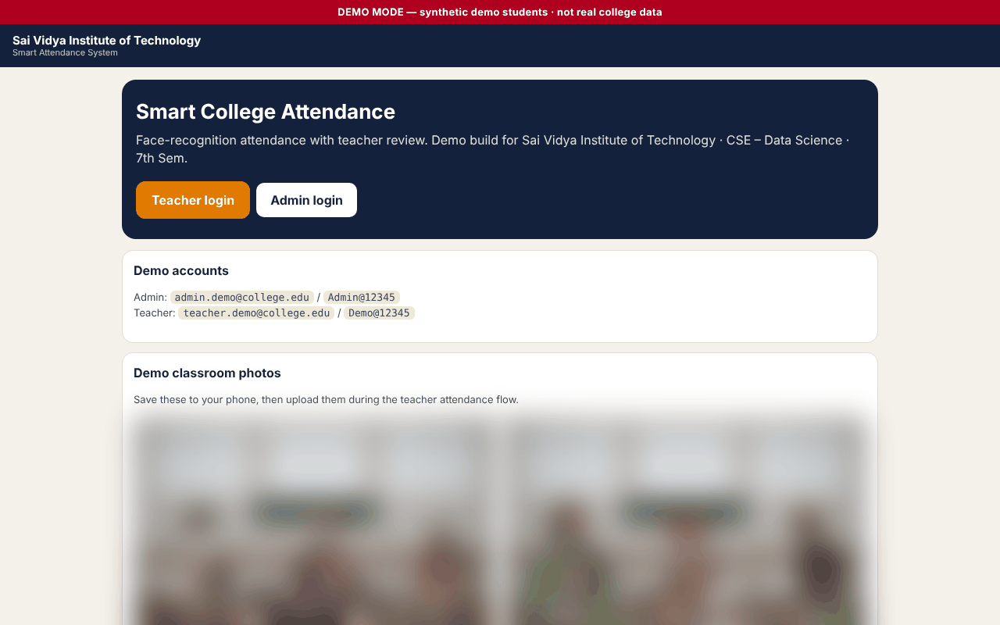 | 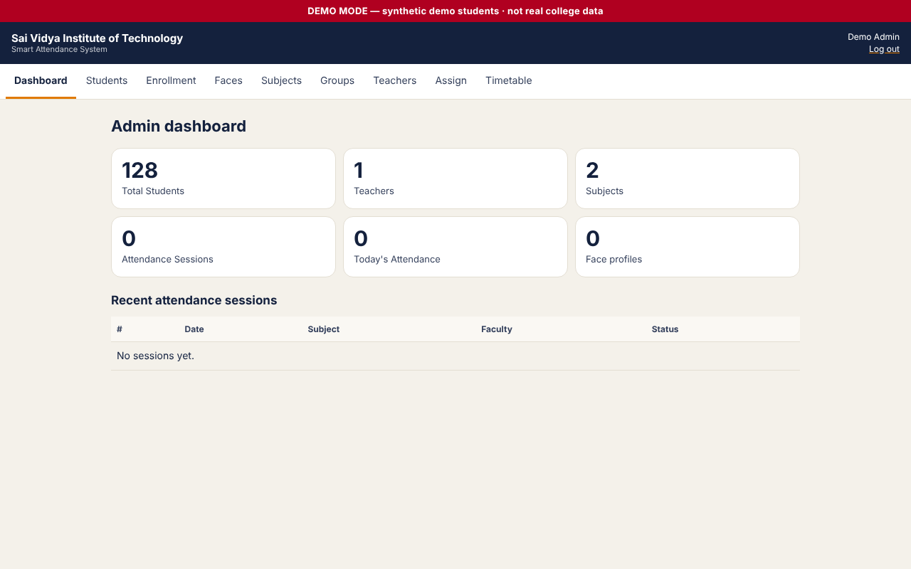 |
| **👥 Students (128)** | **🙂 Face enrollment** |
| 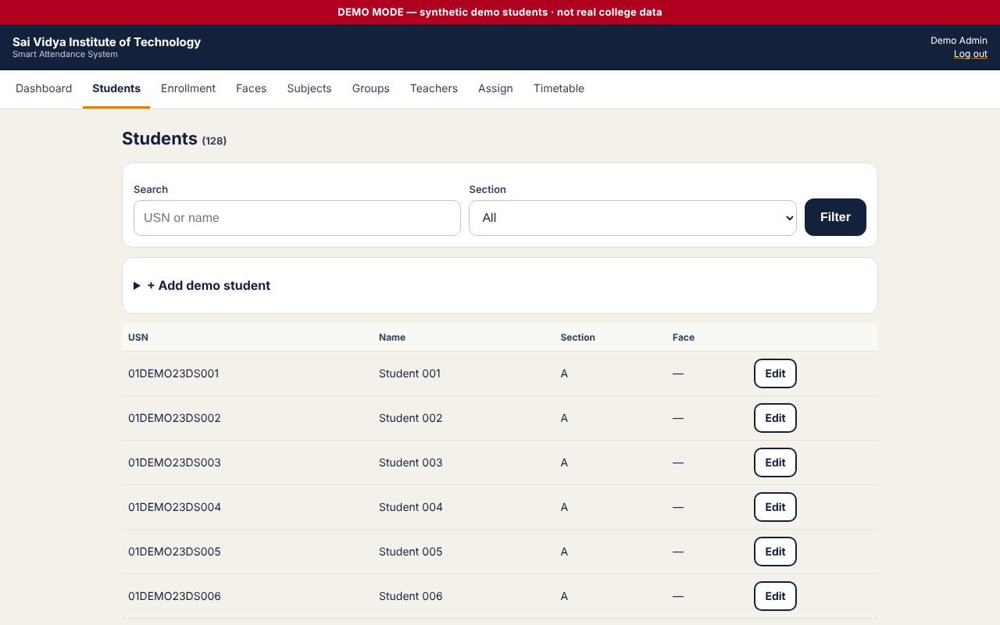 | 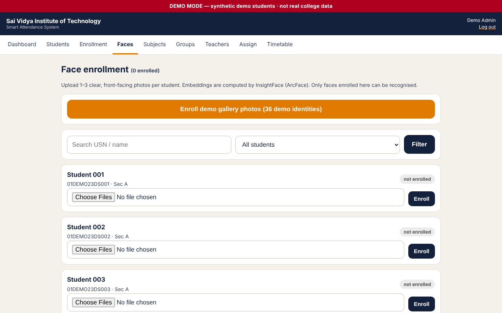 |
| **📚 Subjects** | **🧩 Subject / elective groups** |
| 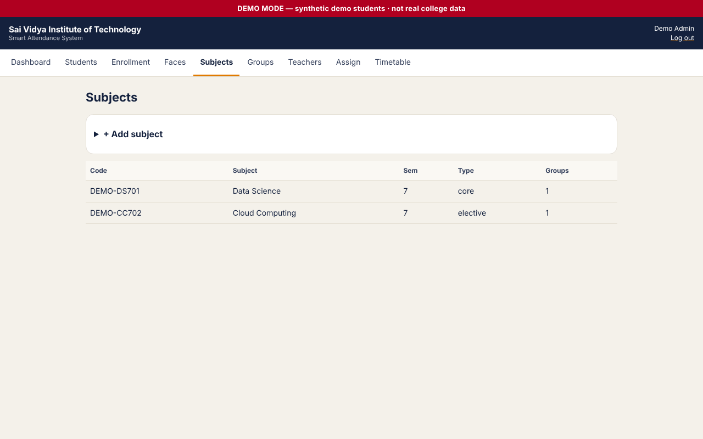 | 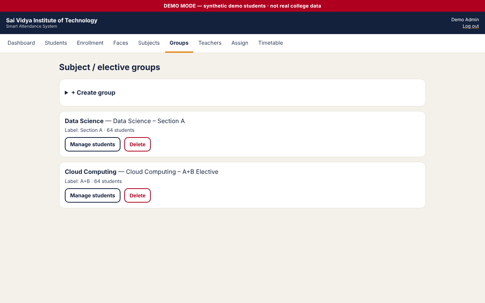 |
| **🗓️ Timetable** | **👩‍🏫 Teachers** |
| 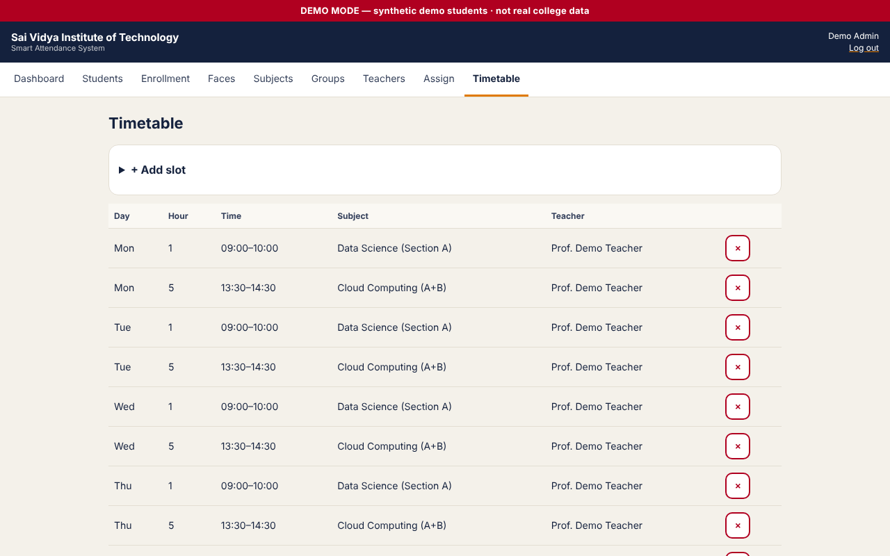 | 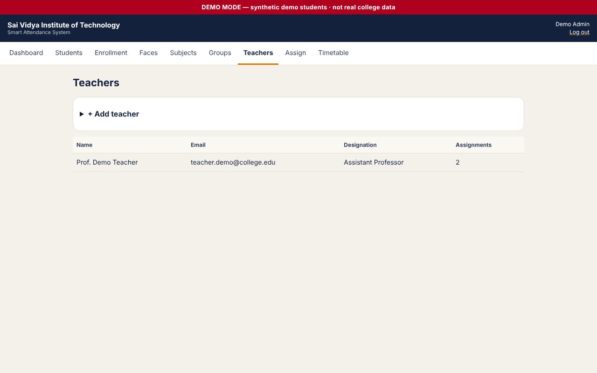 |
| **📅 Teacher: today** | **📘 My classes** |
| 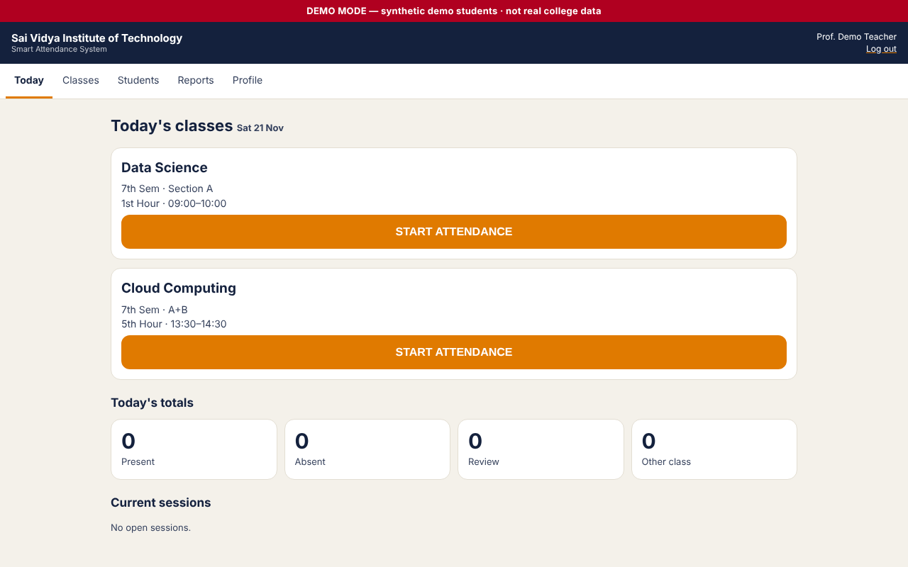 | 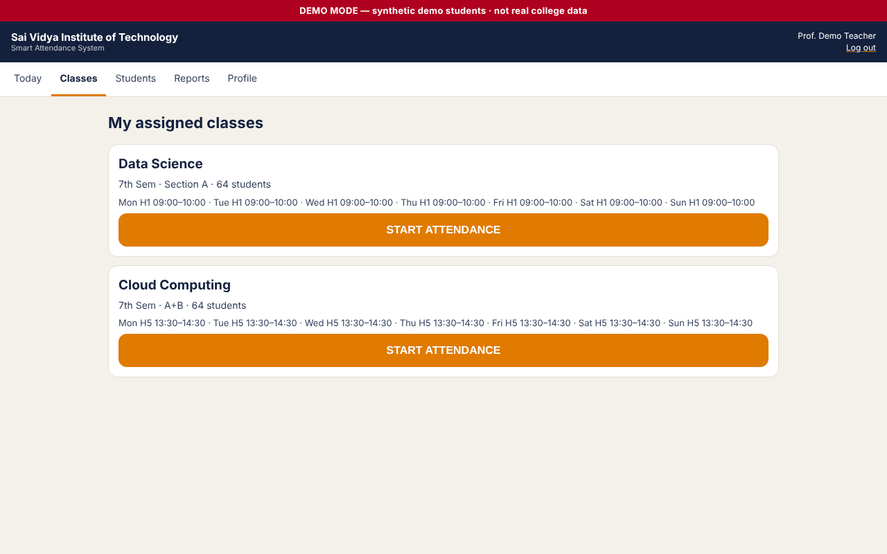 |
| **📸 Take attendance (photos blurred)** | **📄 Reports** |
| 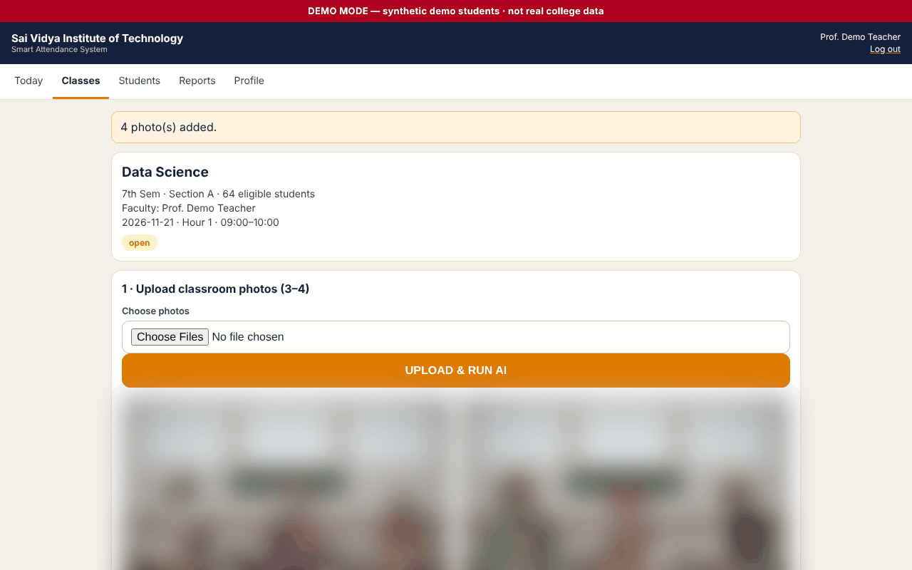 | 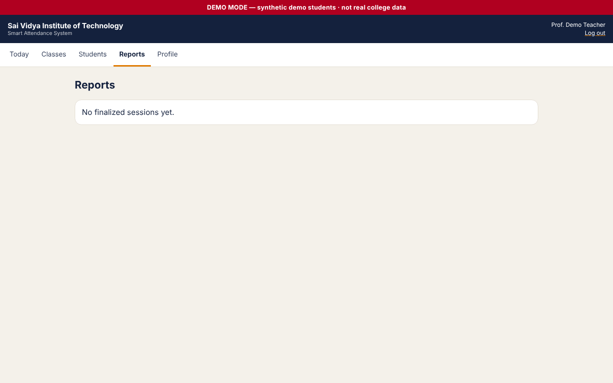 |

| 📱 Mobile: login | 📱 Mobile: teacher dashboard | 🔐 Admin login |
|:-:|:-:|:-:|
| 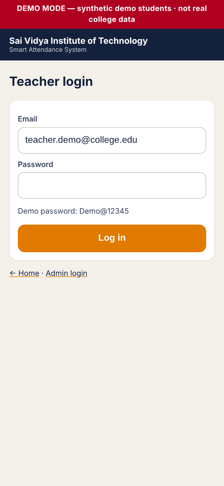 | 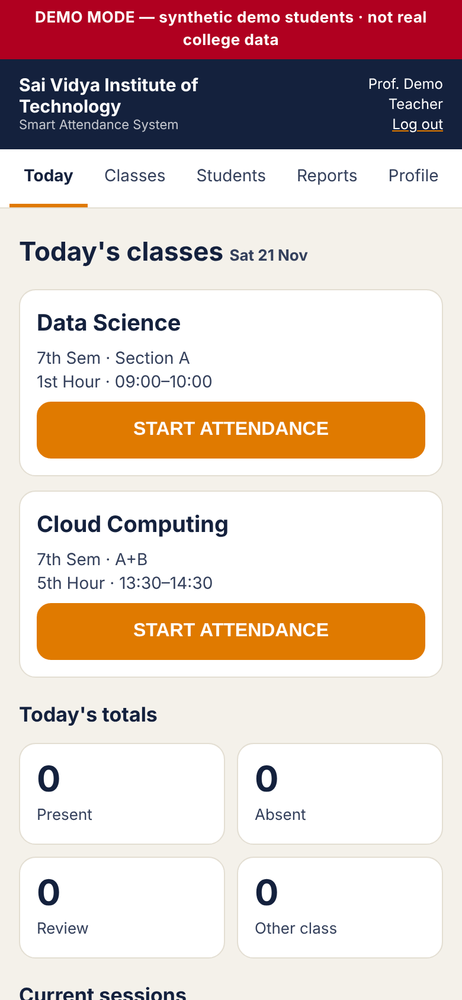 | 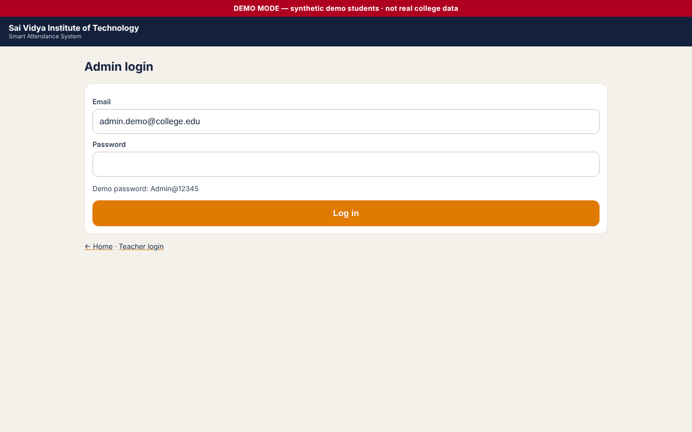 |

## 🧰 Technology stack

| Layer | Tools |
|---|---|
| 🧠 AI / CV | InsightFace (`buffalo_sc`: detector + ArcFace) · ONNX Runtime (CPU) · OpenCV · NumPy · scikit-image |
| ⚡ Backend | Flask 3.1 · Werkzeug · Gunicorn |
| 💾 Storage | SQLite (`app/schema.sql`) · local files for photos, crops and PDFs |
| 📄 Reports | ReportLab |
| 🖥️ Frontend | Server-rendered Jinja templates · custom CSS · mobile-friendly |
| 🧪 Testing | pytest end-to-end acceptance test · Playwright |
| 🚢 Deploy | Docker (one service runs UI + API + AI) · optional Vercel proxy |

## 📁 Project structure

```text
smart-attendance-demo/
├── app/
│   ├── __init__.py        # app factory, routes, demo banner
│   ├── ai.py              # InsightFace engine, detection, embeddings, matching, thresholds
│   ├── pipeline.py        # multi-photo processing, merging, roster check, annotated images
│   ├── enroll.py          # face enrollment (gallery → embeddings)
│   ├── admin.py           # admin pages: students, faces, subjects, groups, teachers, timetable
│   ├── teacher.py         # teacher pages: today, classes, attendance, review, reports
│   ├── reports.py         # Attendance PDF + Other-Class PDF
│   ├── auth.py · db.py · seed.py · schema.sql
│   ├── templates/         # admin/ and teacher/ Jinja templates
│   └── static/style.css
├── demo_assets/           # demo face gallery, 4 classroom photos, manifest.json (see the note below)
├── docs/
│   ├── demo/              # tour video (MP4 + GIF), banner, stills
│   └── screenshots/       # real app screenshots (photos blurred)
├── scripts/
│   ├── build_demo_assets.py   # builds the controlled demo face set
│   ├── seed_demo.py           # (re)seeds the demo database
│   └── demo/render_tour_video.py
├── tests/test_e2e.py      # end-to-end acceptance test (real pipeline + PDFs)
├── Dockerfile · vercel.json · DEPLOY.md · wsgi.py
└── requirements.txt · requirements-dev.txt · .env.example
```

## ⚙️ Installation and setup

```bash
git clone https://github.com/nvaltryek-001/smart-attendance-demo.git
cd smart-attendance-demo

python -m venv .venv
# Windows: .venv\Scripts\activate      macOS/Linux: source .venv/bin/activate
pip install -r requirements.txt

cp .env.example .env        # then set a long random SECRET_KEY
```

On the first run InsightFace downloads its `buffalo_sc` model pack to `~/.insightface`.

## ▶️ Running the application

```bash
python wsgi.py                      # http://127.0.0.1:5000
# production-style
gunicorn -w 1 --threads 8 -t 300 wsgi:app
```

On first start the demo database is seeded automatically (`AUTO_SEED=1`) with 128 students, subjects, groups, timetable and the 18 face profiles. To reset it:

```bash
python scripts/seed_demo.py
```

**Docker**

```bash
docker build -t smart-attendance-demo .
docker run -p 8000:8000 -v sa_data:/data -e SECRET_KEY=$(openssl rand -hex 32) smart-attendance-demo
```

See [`DEPLOY.md`](DEPLOY.md) for hosting notes and the optional Vercel front door.

## 🎤 Demo presentation guide

1. 🏠 Open the **home page** and save the four classroom photos to your phone.
2. 🛠️ Sign in as **admin**: show the 128 students, subjects, groups, teacher assignments and timetable.
3. 🚪 Log out and sign in as the **teacher**: *Today* shows only this teacher's classes.
4. ▶️ **Start attendance** for *Data Science*.
5. 📸 **Upload the 4 photos** and press **Run AI processing**. Watch the progress steps.
6. 🔍 On **Review**, the expected result is 14 present, Student 003 for review, 3 *other class* and 2 unknown.
7. ✅ Confirm Student 003, then **Finalize**.
8. 📄 Download the **Attendance PDF** and the **Other-Class PDF**. They open on a phone too.
9. 🔄 Reload to show that the data persists.

## 🧪 Testing

```bash
pip install -r requirements-dev.txt
pytest -s tests/test_e2e.py
```

The end-to-end test drives the **real Flask routes, the real InsightFace pipeline and the real PDF generator** through the full demo checklist. It uses `manifest.json` only at the end, to validate the results.

## 📄 Reports

| Report | Contents |
|---|---|
| 📄 **Attendance PDF** | Session details (subject, group, date, hour, faculty) and every rostered student with their final status |
| 📄 **Other-Class PDF** | Recognised students who aren't on this subject's roster, with face crops, kept separate so no one is wrongly marked |

## ⚠️ Known limitations

- **Controlled demo data**: 18 enrolled identities and composite classroom images, so real-classroom accuracy is **not measured**.
- Lighting, distance, occlusion (masks, hands), head angle and crowd size all affect recognition.
- Thresholds (`0.50` / `0.35` / margin `0.08`) were chosen for this demo set and need calibration on real data.
- SQLite and local files need a **persistent disk**. Free hosts that sleep lose uploads and PDFs.
- Nothing has been deployed or tested online yet (see `DEPLOY.md`).

## 🏛️ Moving to the real college version

- 🆕 Use a **fresh database, gallery, secret key and credentials**. Never reuse the demo ones.
- ✍️ Get **written consent** from every student before enrolling a face, and publish a retention policy.
- 📸 Enrol 3–5 photos per student under classroom-like conditions.
- 📏 Re-tune thresholds on a labelled pilot, and measure precision and recall per class.
- 🔐 Add HTTPS, strong passwords or SSO, encrypted storage, backups and audit logging.

## 🔮 Future enhancements

- [ ] Live camera capture and a mobile app
- [ ] Per-student attendance percentage and shortage alerts
- [ ] Bulk enrollment via CSV and photo ZIP
- [ ] SMS or email notifications to parents
- [ ] Integration with the college ERP or LMS
- [ ] Anti-spoofing (liveness) checks

## 📜 Dataset source, license and responsible use

Demo faces come from **LFW (Labeled Faces in the Wild)**, via [deepfunneled_lfw](https://github.com/redwankarimsony/deepfunneled_lfw), and are used for research and demonstration only. LFW images are of real people. Don't use them to identify anyone, and respect the dataset's terms.

Face data is **biometric data**. Any real deployment needs informed consent, a lawful basis under the applicable data-protection law (for example India's DPDP Act 2023), minimal retention and human review of every decision.

<div align="center">

---

**Built with 🎓 + 🤖 to give teachers their lecture time back**

⭐ If you found this project useful, please give it a star!

</div>
